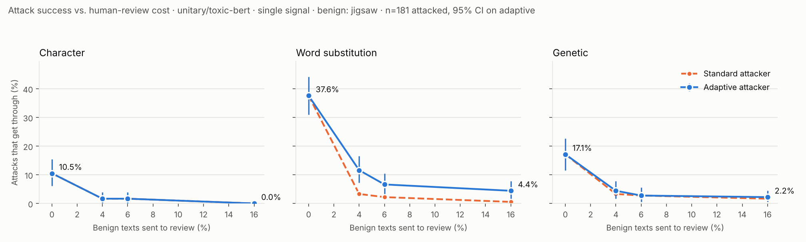

# Selective Guardrail Evaluation

**Can a content-moderation guardrail be evaded, and can it tell when it is
being fooled?**

Safety guardrails are the classifiers that sit in front of (or alongside) a
large language model to catch harmful text. Most jailbreak research attacks
the LLM itself. This project attacks the guardrail instead, then asks a
second question: if the guardrail is allowed to send uncertain cases to a
human reviewer, how much evasion does that stop, how much human review does
it cost, and does it still work against an attacker who knows the policy?

| Part | What it asks | Authors |
|---|---|---|
| **1. Robustness study** | How easily can three open moderation classifiers be evaded with character, word, paraphrase, genetic and universal-trigger attacks? Do the evasions transfer between models? Does adversarial fine-tuning help? | Malvika Rajeev Kappadan and Samiksha Prasad ([original repo](https://github.com/MALVIKA2701/guardrail_redteam_ready)) |
| **2. Deferral study** | Can a three-way guardrail (block / defer to a human / allow), calibrated to a fixed human-review budget, stop attacks that a binary guardrail lets through, including adaptive attacks aimed at the deferral band itself? | Samiksha Prasad (`deferral/`, `deferral_study.py`, [`DEFERRAL.md`](DEFERRAL.md)) |

Everything runs on open-weight models on a CPU or a free Colab GPU. No paid
API is needed; the black-box API targets in Part 1 are optional.

## Results

First full run: `unitary/toxic-bert`, Jigsaw toxic comments, 181 attacked
toxic texts, 100 calibration and 100 test benign texts, single-model
deferral signal. Brackets are 95% bootstrap confidence intervals.



**Attack success rate (ASR) against an adaptive attacker that knows the band**

| Review budget | Benign texts sent to review (test set) | Character | Word substitution | Genetic |
|---|---|---|---|---|
| 0% (binary guardrail) | 0% | 10.5% | 37.6% [30.9, 44.2] | 17.1% |
| 5% | 4.0% [1.0, 8.0] | 1.7% | 11.6% [7.2, 16.6] | 4.4% |
| 10% | 6.0% [2.0, 11.0] | 1.7% | 6.6% [3.3, 10.5] | 2.8% |
| 20% | 16.0% [9.0, 23.0] | 0.0% | 4.4% [1.7, 7.7] | 2.2% |

What this shows:

- **A small review budget removes most evasions.** Sending about 4–6% of
  benign text to review cuts the strongest attack (word substitution) from
  37.6% to 11.6% at a 5% budget and 6.6% at a 10% budget. The realized
  review rate stayed within budget at every level.
- **Non-adaptive evaluation overstates the defense.** Against the standard
  attacks, which stop as soon as they cross 0.5, the band at a 5% budget
  appears to cut word-substitution success to 3.3%. The adaptive attacker
  reaches 11.6%, about 3.5 times higher.
- **The effects are significant.** Every reduction from the binary
  guardrail is significant under paired McNemar tests with Holm-Bonferroni
  correction across all budget × attack comparisons (adjusted p < 0.001 for
  every attack at the 5% and 10% budgets).
- **It also catches ordinary misses.** Without any attack, toxic-bert lets
  9.5% of toxic comments through. With the 5% band, only 0.5% are allowed;
  the rest go to review.
- **Why it works on this model:** toxic-bert scores almost all benign Jigsaw
  comments below 0.03, while attacked toxic texts usually land between that
  and 0.5, where the band catches them.

ASR is the share of attacked toxic texts the guardrail ends up allowing.
Full tables, McNemar tests with Holm correction, and query counts are in
`results/deferral_summary_single.md` and `results/deferral_results_single.json`.

**Caveats.** Results are from one model, one dataset and one run. Jigsaw's
benign comments are mostly mild; benign but heated or profane text would
score higher and make the band more expensive; `run_deferral_suite.sh`
tests this directly with a "hard benign" set, plus all three classifiers
and three seeds. The no-band word-attack ASR
differed slightly between two runs on identical inputs (37.6% vs 34.2%),
probably GPU non-determinism near the 0.5 threshold, so treat differences
of a few points as noise. The ensemble signal is being rerun after a
calibration fix (see `DEFERRAL.md`).

## Quick start

```bash
python3 -m venv .venv && source .venv/bin/activate
pip install torch --index-url https://download.pytorch.org/whl/cpu   # or the CUDA build on a GPU
pip install -r requirements.txt
python -c "import nltk; nltk.download('wordnet'); nltk.download('omw-1.4')"

python -m pytest tests/ -q                         # 86 offline tests, no downloads

# Part 2: deferral study
python deferral_study.py --mock --n_samples 8      # offline smoke test
python deferral_study.py --n_samples 400 --attacks char,word,genetic
bash run_deferral_suite.sh                         # every setting + figures (~1 h on a free Colab GPU)

# Part 1: robustness study
./run_fast.sh
```

The first real run downloads the classifiers and the Jigsaw dataset from
huggingface.co. See `ARCHITECTURE.md` for the Part 1 pipeline and design
rationale, and `DEFERRAL.md` for Part 2.

## Research Design

### Threat model
- **Gray/white-box surrogates** (full logit access, CPU-friendly, open
  weights): a registry of three architecturally distinct toxicity/moderation
  classifiers (`config.LOCAL_SURROGATE_REGISTRY`) — `unitary/toxic-bert`,
  `martin-ha/toxic-comment-model`, and
  `facebook/roberta-hate-speech-dynabench-r4-target`.
- **Black-box targets** (score/decision only, no gradients): OpenAI
  Moderation API and Perspective API.

### Attack families (three granularities + one "universal" variant)
| Attack | File | Granularity | Technique family |
|---|---|---|---|
| Character perturbation | `attacks/char_attacks.py` | character | homoglyphs, leetspeak, zero-width chars, typos + greedy search |
| Word substitution | `attacks/word_substitution_attack.py` | word | TextFooler-style importance-ranked synonym substitution |
| Paraphrase | `attacks/paraphrase_attack.py` | sentence | LLM-based meaning-preserving rewrites |
| Genetic search | `attacks/genetic_search_attack.py` | mixed (word+char) | population-based, score-guided black-box optimization; usable directly against black-box APIs, not just local surrogates |
| Universal trigger | `attacks/trigger_search_attack.py` | cross-example | black-box beam search for one reusable suffix that degrades many inputs at once, evaluated on a held-out split |

Testing three granularities plus a universal-trigger variant lets the
project answer a richer question than "can this be evaded?" — namely *at
what level of the input* guardrail models are most fragile, and whether
vulnerabilities are per-example or systemic.

### Transfer studies (two levels)
- **Cross-model transfer** (`multi_model_study.py`): attacks are optimized
  against one local surrogate, then replayed against the other surrogates
  with zero adaptation, producing a full transfer matrix. Tests whether
  guardrail architectures share a common blind spot.
- **Black-box API transfer** (`transfer_study.py`): the same surrogate-optimized
  attacks are replayed against production moderation APIs, testing whether
  the vulnerability generalizes beyond open-weight research models.
- **Direct black-box optimization** (`blackbox_direct_attack_study.py`): a
  score-guided genetic algorithm (`attacks/genetic_search_attack.py`) is run
  directly against the production APIs, querying their real continuous
  score every generation, rather than only replaying a surrogate-optimized
  attack. This is the stronger, more realistic black-box threat model, and
  its ASR is meant to be compared against `transfer_study.py`'s transfer
  rate for the same API to see how much attack strength surrogate-replay
  alone leaves on the table.

### Universal trigger generalization (important methodological point)
The universal trigger (`attacks/trigger_search_attack.py`) is optimized on
one batch of examples and evaluated on a **disjoint held-out batch it never
saw during search** (`universal_trigger_study.py`, controlled by
`config.TRIGGER_HOLDOUT_FRACTION`). The headline "universal trigger" claim
must be reported using the **held-out success rate**, not the optimize-set
score — optimizing and evaluating on the same examples would measure
overfitting to that batch, not genuine generalization. The study also
reports a `generalization_gap` (optimize-set success rate minus held-out
success rate) so overfitting is visible rather than hidden.

### Statistical rigor (`stats.py`)
- Bootstrap confidence intervals on Attack Success Rate (not bare point
  estimates).
- Paired McNemar significance tests between attack methods on shared
  examples, so claims like "word substitution significantly outperforms
  character substitution" are backed by a p-value.
- **Multiple-comparisons correction (Holm-Bonferroni)** applied across every
  pairwise test run: within `compare_attacks()` for a single classifier, and
  across the FULL family of (model × attack-pair) tests in
  `compare_attacks_across_models()` for the multi-model study. Running k
  pairwise comparisons uncorrected inflates the family-wise false-positive
  rate — e.g. 3 pairwise tests at alpha=0.05 uncorrected gives roughly a 14%
  chance of at least one spurious "significant" result even with no real
  difference anywhere. Every comparison reports both
  `significant_uncorrected` and `significant_after_correction` so the
  difference is visible.
- **Effect sizes alongside every corrected p-value.** A significant
  McNemar result only says two attacks differ; it says nothing about how
  much. Every pairwise comparison also reports an odds ratio (from McNemar's
  own 2x2 table, Haldane-Anscombe corrected) and a bootstrap confidence
  interval on the raw ASR difference (`paired_asr_difference_ci`), so a
  tiny, practically meaningless gap that happens to be "significant" is
  visibly tiny, not just flagged as significant.
- **Seed variance for stochastic search procedures.** The universal trigger
  search (`universal_trigger_study.py`) and the direct black-box genetic
  attack (`blackbox_direct_attack_study.py`) are both stochastic. Both now
  run multiple independent seeds and report mean/std/min/max (via
  `stats.seed_variance_summary`) instead of a single run's number — a
  single seed can't distinguish a genuinely strong/generalizing result from
  one lucky search.

### Ablations (`ablations.py`)
- ASR vs. query budget (does success rate saturate, and where?)
- ASR vs. minimum semantic-similarity threshold (what's the robustness/
  stealth trade-off?)

### Defense (`defense/adversarial_finetune.py`)
Fine-tunes a surrogate on a mix of clean + successfully-attacked examples
(adversarial training) and reports before/after ASR, so the project
contributes a mitigation alongside every attack, not attacks in isolation.
Critically, it also reports **clean-data accuracy, false-positive rate, and
false-negative rate on a fresh, disjoint, labeled evaluation set** before
and after fine-tuning — a defense that drops ASR by flagging everything is
not a real improvement, and this makes that failure mode visible rather
than hiding behind a single "ASR went down" headline.

### Extension: deferring to human review (`deferral/`, `deferral_study.py`)
Instead of only blocking or allowing, a selective guardrail can send inputs
it is unsure about to human review. This extension calibrates a deferral
band to a chosen human-review budget (split-conformal, on held-out benign
text), then measures how much evasion it stops against both the standard
attacks and an **adaptive attacker that knows the band exists**. Signals:
the primary model's own score, or disagreement across the classifier
ensemble. See `DEFERRAL.md` for the question, method and how to read the
results.

### Perturbation cost (`metrics/perturbation_cost.py`)
Every attack result is paired with normalized character edit distance and
semantic similarity, so "success" that mangles text into gibberish is
distinguishable from success that preserves fluent, natural language.

### Reporting
- `visualize_results.py` — generates all plots (ASR bar chart with CI error
  bars, cross-model transfer heatmap, ablation curves, perturbation-cost
  histograms, defense before/after comparison) as PNGs.
- `generate_report.py` — aggregates every result file into a single
  `results/report.md` with embedded figures, ready to hand to a supervisor
  or paste into a write-up.

## Engineering quality

- **`tests/`** — 86 unit tests covering attack logic, metrics, deferral, and
  statistics, all running fully offline against `MockClassifier` and
  pure-Python fallbacks (no model downloads or network access required).
  Run with `pytest tests/ -v`.
- **`.github/workflows/ci.yml`** — runs the offline test suite automatically
  on every push/PR.
- **`ARCHITECTURE.md`** — pipeline diagram and design-decision rationale.

## Quickstart (fast run)

```bash
python3 -m venv venv && source venv/bin/activate
pip install torch --index-url https://download.pytorch.org/whl/cpu   # or the CUDA build if you have a GPU
pip install -r requirements.txt
python -c "import nltk; nltk.download('wordnet'); nltk.download('omw-1.4')"
./run_fast.sh
```

Needs network access to huggingface.co on the first run (models + dataset
are cached afterwards). If the Jigsaw HF mirrors are unavailable, download
Kaggle's `train.csv` for the Toxic Comment Classification Challenge and run
with `JIGSAW_CSV=/path/to/train.csv ./run_fast.sh`.

## Setup

```bash
python3 -m venv venv && source venv/bin/activate
pip install torch --index-url https://download.pytorch.org/whl/cpu
pip install -r requirements.txt
```

You will additionally need, depending on which components you use:
- Network access to **huggingface.co** (downloads the surrogate classifiers,
  the sentence-embedding model, and the toxicity datasets)
- An **`OPENAI_API_KEY`** env var for the OpenAI Moderation black-box target
- A **`PERSPECTIVE_API_KEY`** env var for the Perspective API black-box target

If you don't have API keys yet, leave `config.USE_API_TARGETS = False` — the
local-surrogate and cross-model-transfer results (the bulk of the project)
don't need them.

## Running the full pipeline

```bash
# 0. Sanity-check the pipeline works with zero dependencies
python run_experiment.py --mock --n_samples 8

# 1. Real attack evaluation against the primary surrogate
python run_experiment.py --dataset jigsaw_toxicity_pred --n_samples 200 --attacks char,word,genetic,paraphrase

# 2. Cross-model study (all three surrogates + transfer matrix + corrected stats)
python multi_model_study.py --n_samples 100 --attacks char,word,paraphrase

# 3. Universal trigger, with proper optimize/held-out split
python universal_trigger_study.py --n_samples 150

# 4. Black-box API transfer (surrogate-optimized attacks replayed on APIs)
python transfer_study.py --results results/attack_results.jsonl

# 5. Direct black-box optimization against the APIs themselves (stronger, costs real queries)
python blackbox_direct_attack_study.py --n_samples 20 --max_queries 60

# 6. Statistical analysis (bootstrap CIs, Holm-corrected McNemar tests)
python stats.py --results results/attack_results.jsonl

# 7. Ablations
python ablations.py --n_samples 60

# 8. Defense: adversarial fine-tuning + before/after ASR AND clean-data cost
python defense/adversarial_finetune.py --results results/attack_results.jsonl

# 9. Generate all figures + the consolidated report
python visualize_results.py
python generate_report.py
```

Open `results/report.md` for the final consolidated writeup with embedded
figures.

## Dataset

Uses public, already-labeled toxicity datasets — no novel harmful content is
authored as part of this project:
- Jigsaw Toxic Comment Classification (HF: `jigsaw_toxicity_pred`)
- HateXplain (HF: `hatexplain`)

`data/load_data.py` handles downloading and a small fixed local fallback
sample (clearly marked, non-toxic placeholder strings) for offline
smoke-testing the pipeline without network access.

## Verified

The full pipeline (all three attacks, stats, ablations, visualization, report
generation) has been run end-to-end offline using `MockClassifier` and the
rule-based paraphrase fallback, confirming every script executes without
errors and produces the expected output files. The attack search logic
itself was separately verified to work correctly (e.g. driving a flagged
score from 0.98 → 0.05 while preserving semantic similarity, under a
permissive similarity function).

**Known caveat in offline/fallback mode only:** without `sentence-transformers`
installed, `SemanticSimilarity` falls back to a crude word-level Jaccard
metric, which is too strict for character-level perturbations (changing one
character inside a word makes that whole word "not match"). This makes ASR
look artificially low (near 0%) only when running fully offline in `--mock`
mode. Once you install the real dependencies with network access, real
sentence embeddings are used and this resolves — real experiments/paper
results should always be run with the full dependencies installed.

## Responsible use / ethics note

- All attacks are evaluated against classifiers, not used to actually publish
  harmful content anywhere.
- No novel harmful text is authored as attack payloads beyond what already
  exists in public labeled datasets used for robustness research.
- The universal trigger search uses only semantically-neutral filler phrases
  (e.g. "by the way", "for context") as its candidate pool — no
  task-specific harmful content.
- Findings involving any third-party production API are intended for
  responsible disclosure to the provider, per standard adversarial ML
  research norms.
- The defense contribution (adversarial fine-tuning) is reported alongside
  every attack result so the project is not attack-only.

### Direct black-box attacks against production APIs (`blackbox_direct_attack_study.py`)

This is the one part of the project that queries a live, third-party
production system rather than an open-weight model you can run and inspect
locally. It's legitimate adversarial-robustness research, but it's the part
most worth being explicit about:

- **Capped query budget.** `config.MAX_TOTAL_API_QUERIES_PER_RUN` is a hard
  ceiling on total real API queries per script invocation, enforced by a
  `QueryBudgetGuard` regardless of what `--n_samples`, `--max_queries`, and
  `--n_seeds` are set to. This keeps usage well within free-tier / reasonable
  limits and prevents runaway query volume against a system you don't own.
- **No targeting of live user content.** Every input scored comes from
  existing public toxicity-benchmark datasets (Jigsaw, HateXplain), never
  from real users' live messages or content. There is no attempt, intent, or
  mechanism in this project to cause a moderation failure on anything other
  than research-dataset text scored for measurement purposes.
- **Coordinated disclosure.** Any specific successful adversarial example or
  discovered trigger string is intended to be responsibly disclosed to the
  relevant provider (OpenAI, Google/Jigsaw for Perspective) before any
  publication, consistent with standard adversarial-ML and security research
  norms — the goal is characterizing and fixing a weakness, not publishing a
  working exploit.
- **Explicit opt-in required.** The script refuses to run against real APIs
  unless invoked with `--i-accept-responsible-use`, which forces a
  conscious acknowledgment of the above before any live queries are sent.
